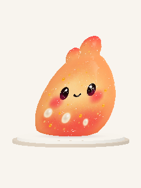

# Meshy Peach — actual Unity comparison

Captured in Unity 6000.6.5f1 / Built-in RP from code `79cc98bb` in [CI 38315430626](https://github.com/calonchozuluaga/pockle/actions/runs/38315430626), October 12, 2026. Graphics: llvmpipe LLVM 15 software rendering. These are actual unretouched Unity ReadPixels captures, not Blender renders or phone performance evidence. Meshy art: 3,951 vertices / 3,845 triangles; 2K texture, existing gel interaction. 41/41 Unity tests passed (15 EditMode + 26 PlayMode), no skips.

These inline review copies are 240×320; full 720×960 PNGs are in [the Unity capture artifact](https://github.com/calonchozuluaga/pockle/actions/runs/38315430626/artifacts/11776732740), under meshy-peach.

| Uploaded Meshy Peach | Prior authored Pip reference |
| --- | --- |
|  |  |

| Meshy three-quarter | Meshy grip/stretch |
| --- | --- |
|  |  |

The painted eyes, smile, blush and pearl details belong to the uploaded texture/mesh. Additional authored face/crown/filling objects are omitted. Material uses bounded moving wet reflections, wrapped light and a transmission/backlight approximation, with opaque depth. Internal refraction/pearl geometry is not present. Original resting silhouette is retained rather than resculpted.

Runtime lives in [PR #15](https://github.com/calonchozuluaga/pockle/pull/15), branch `codex/meshy-peach-test`. Android packaging/main merge status is recorded there. This evidence branch adds only review images/docs to the same source; use the runtime branch or main after its merge for the phone build.
