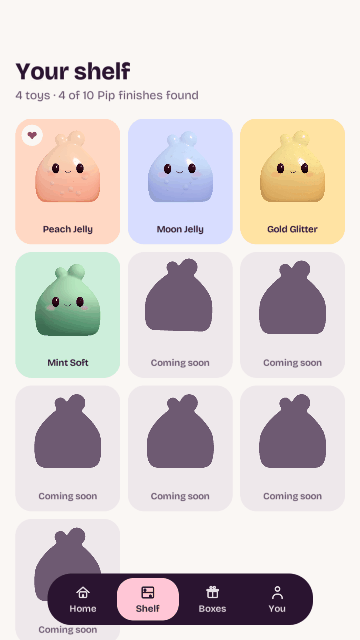
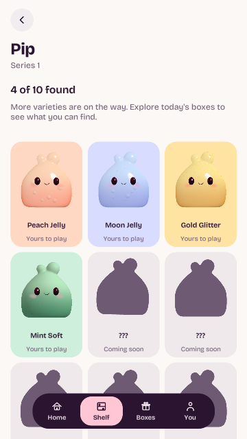
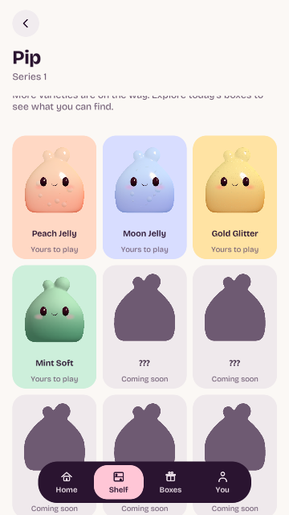
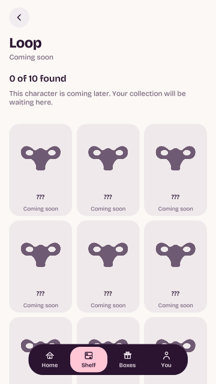

# Animated Shelf and missing silhouettes — actual Unity review

Tested code: [47093ee](https://github.com/calonchozuluaga/pockle/commit/47093eef9182e74af0cd9c10726643bf53d978e0), [PR #14](https://github.com/calonchozuluaga/pockle/pull/14), branch `codex/animated-shelf`. This branch holds review evidence; build main after the PR merge.

Pip's Shelf and Collection each have ten slots: four available finishes and six planned silhouettes. Found toys use real mesh idles. Missing entries use face-free outlines, with a short eager greeting followed by a rest beat. Names/finishes stay hidden; planned entries say Coming soon and cannot open a toy. Motion calm restores still portraits/resting outlines and stops live rendering.

Both GIFs assemble eight actual UI frames, displayed at 300 ms/frame. They are excerpts, not interpolated full animation cycles. GIF palette encoding reduces colours; no art retouching or generated frames. The greeting's rest beat is visible before the hop. Found toys and silhouettes share four visible motion slots so neither group is starved; overflow cells stay still.

Pip's outline projects the authored body. Planned characters use lightweight outline-only studies based on ART-001, without adding available runtime models. Secret placeholders hide identity with a generic outline. Box artwork and the tactile viewer remain separate.

## Validation

- [Run 38301425639](https://github.com/calonchozuluaga/pockle/actions/runs/38301425639): **37/37 Unity tests**, 13 EditMode / 24 PlayMode, zero failed/skipped. Hosted portable/source/whitespace passed.
- Tests verify actual mesh deformation, shared motion/camera/texture limits, calm rendering stop, pause, hidden pages, fully occluded cards, HUD disable/re-enable, native texture disposal, eager silhouettes, unchanged ownership, unavailable-toy refusal, concealed secrets and full ten-slot Missing/progress behavior.
- **543,484 portable assertions**, including the real Shelf tab and Back/scroll history. Source checks: 68 C# files / three profiles / five assemblies / 148 GUIDs / zero failures. Existing metadata preserved; published tree matches local checked files plus unchanged remote packaging PNG.
- **Unity 6000.6.5f1 / Built-in RP / llvmpipe (LLVM 15.0.7, 256 bits)**. Nineteen actual UI frames decoded from CI log RGB/gzip previews. Portrait render target 720×1280 with a matching logical HUD scale, independent of the editor Game View resolution; safe-area/device behavior still needs a phone.
- Shared pool: four visible motion slots, one disabled manually rendered camera, at most four reusable 192×192 live targets, 15 fps captures. Static Home/avatar/fallback portraits remain shared. Calm/hidden/modal/paused/focus-lost/disabled/disposed views stop live motion.
- Published previews are **360×640**. [Full 720×1280 PNG artifact](https://github.com/calonchozuluaga/pockle/actions/runs/38301425639/artifacts/11771795486) includes all 19 UI captures and existing Pip material captures.

Android packaging passed in the same CI run: [APK artifact](https://github.com/calonchozuluaga/pockle/actions/runs/38301425639/artifacts/11770618384). PR #14 is merged into main at **1d9c1257**; pull main for the next test. Phone layout, motion feel, frame time, GC allocation and texture memory remain owner checks in [SHELF_MOTION_REVIEW.md](../../SHELF_MOTION_REVIEW.md). Resource bounds and hosted timings do not establish phone performance. Pip material/art is unchanged in this task and still awaits the owner's feedback.
